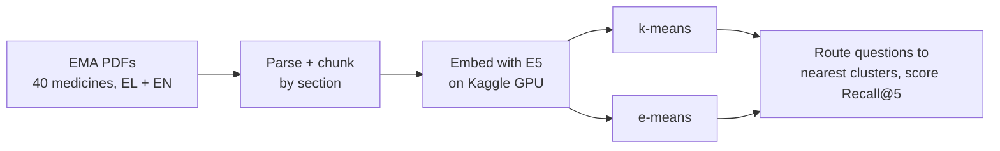

# MedLeaf: k-means vs e-means on medicine embeddings

[](https://github.com/NickLitharis/medleaf-rag/actions/workflows/ci.yml)
[](LICENSE)

An algorithmic comparison, not a service. It asks whether clustering E5 embeddings of
official EU medicine information with **e-means**
([arXiv:2611.09501](https://arxiv.org/abs/2611.09501)) works as well as **k-means**, when
the clusters are used to narrow a search, and whether it is faster or tighter.

The text is the EMA product information (the SmPC and the package leaflet) of 40 medicines
in Greek and English. The question set has gold sections, so a clustering is scored by
how often the right section is still found, using the project's own Recall@5.

*Source of the corpus: European Medicines Agency (EMA) - ema.europa.eu. See `NOTICE.md`.*

## How it works



The plan, settings and decision rule are in
[`experiments/e-means/PLAN.md`](experiments/e-means/PLAN.md).

## Run it

```bash
python -m pip install -e ".[compare,dev]"
cd experiments/e-means/kaggle

# 1. Once: a small kernel downloads and checksum-verifies the PDFs (needs a Kaggle token)
kaggle kernels push -p ema-pdfs

# 2. Embed on a GPU; this reads kernel 1's output, so EMA is not contacted again
kaggle kernels push -p full-corpus --accelerator NvidiaTeslaT4
kaggle kernels output nikoslitharis/medleaf-embed-corpus -p ../out

# 3. Compare the clusterings, offline and repeatable
cd .. && python experiment.py out
```

The first kernel leaves out any PDF whose checksum no longer matches `data/medicines.yaml`
(EMA has published a newer version) and lists it in `manifest.json`.

## The corpus tools

`medleaf` is a small command line for the corpus: `resolve` EN/EL PDF URLs from EMA,
`download` them with pinned checksums, `check` section coverage, and print the `tables`
of side-effect rows. The parser and chunker are in `src/medleaf/ingest`, the embedding
wrapper in `src/medleaf/embed.py`, and the scoring in `src/medleaf/eval`.

```bash
python -m pip install -e ".[dev]"
python -m pytest -q        # fast tests; the real-corpus checks stay skipped
python -m ruff check .
```

## History

This repository used to be a bilingual RAG question-answering service (hybrid search over
Qdrant, cited answers, safety redirects). That code is kept at the git tag `rag-service`.

## Licence

MIT for the code. The medicine texts belong to EMA; see `NOTICE.md`.
