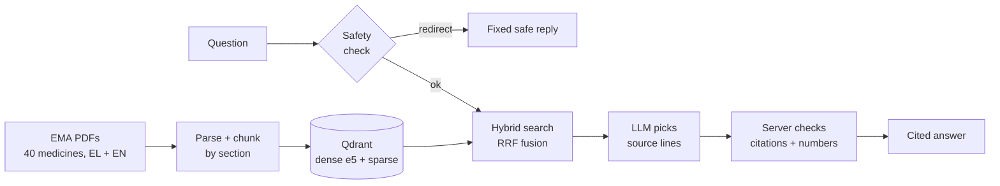

# MedLeaf RAG

[](https://github.com/NickLitharis/medleaf-rag/actions/workflows/ci.yml)
[](LICENSE)

**Ask questions about EU medicines in Greek or English and get answers quoted from
official EMA documents, with a link to every source.**
Hybrid search (dense + keyword) over 8,797 chunks from 40 medicines, with safety
redirects for personal-treatment and emergency questions.

**Stack:** Python 3.11 · FastAPI · Qdrant · sentence-transformers (multilingual-e5) ·
OpenAI-compatible LLM API · Docker Compose · GitHub Actions

<p>
  
  
</p>

## How it works



## Quick start (Docker)

You need only Docker (with Compose) and about 4 GB of free disk space. Search works
without any key. Ask needs an OpenAI-compatible LLM key; a free
[NVIDIA developer key](https://build.nvidia.com/) works.

1. Clone the repo and create your settings file:

   ```bash
   git clone https://github.com/NickLitharis/medleaf-rag.git
   cd medleaf-rag
   cp .env.example .env      # PowerShell: Copy-Item .env.example .env
   ```

   For Ask, set `MEDLEAF_LLM_API_KEY=` in `.env` to your key. `.env` is gitignored,
   and Compose reads it automatically.

2. Download the 80 EMA PDFs (about 185 MB; checksums are pinned in
   `data/medicines.yaml`). The first run also builds the 2 GB Docker image.

   ```bash
   docker compose run --rm indexer python -m medleaf.cli download --workers 2
   ```

3. Build the index once. This takes about 75 minutes on CPU and downloads a 1 GB
   embedding model.

   ```bash
   docker compose run --rm indexer
   ```

4. Start the API and open <http://127.0.0.1:8000/>.

   ```bash
   docker compose up -d api
   ```

The first question after a start loads the embedding model and takes about a minute.
`docker compose down` stops everything. The index stays in `data/` and the Qdrant
volume, so step 4 alone restarts the demo.

## What works

- **Bilingual hybrid retrieval.** Dense e5 embeddings and sparse keyword vectors with
  Greek accent folding and suffix stemming, fused with RRF. On the held-out eval set,
  Recall@5 is 84.2% (dev, 48/57) and 86.0% (test, 49/57).
- **Cited answers.** In extractive mode the model only picks source lines by ID. The
  server shows the original EMA text with a citation link.
- **Safety first.** Emergency questions get a fixed reply with EU and Greek emergency
  numbers, without calling the LLM. Personal-treatment questions are redirected to a
  doctor or pharmacist.
- **Number guard.** The server blocks an answer that contains digits not found in the
  quoted sources.
- **CI.** Lint and fast tests run on every push. A retrieval eval gate
  (`.github/workflows/eval-retrieval.yml`) fails a PR that loses more than one
  Recall@5 hit.

## What's next

- A downloadable index snapshot, so the quick start skips the 75-minute build.
- Better Greek ranking: saturated (BM25-style) term weights on the sparse vectors.
- Answer-quality evaluation with a real model, beyond the targeted numerical checks.

The original milestone plan is in `SPEC.md`; design decisions are in `docs/decisions.md`.

## Try these questions

Ask detects the answer language from the question. The dropdown filters apply only to
Search.

- `What is Eliquis used for?`: an English answer with EMA source links.
- `Ποιες είναι οι ανεπιθύμητες ενέργειες του Ozempic;`: the Greek path.
- `Should I stop taking Eliquis?`: a personal-treatment redirect.
- `I took too many Eliquis tablets`: an emergency redirect, with no LLM call.
- `What does the product information say about Eliquis curing the common cold?`:
  an unsupported claim. The expected answer is that the sources do not cover it.

## Medical disclaimer

This project is not medical advice and is not a substitute for a doctor or
pharmacist. Do not use it to decide on a dose, to stop or change a medicine, or in
an emergency. In an emergency in the EU, call 112.

## Development

Python 3.11 or later. The retrieval stack (torch, sentence-transformers, Qdrant
client, FastAPI) is an extra, so a plain checkout stays light:

```bash
python -m pip install -e ".[dev]"            # lint, type checks and the fast tests
python -m pip install -e ".[api,retrieval]"  # index build + API
python -m pytest -q                          # fast tests, in-memory Qdrant
python -m ruff check .
```

On a machine that already has a CPU torch, a virtualenv with
`--system-site-packages` reuses it instead of downloading torch again:

```bash
uv venv --system-site-packages --python 3.11 .venv
uv pip install --python .venv/Scripts/python.exe -e ".[api,retrieval,dev]"
```

The embedding model is pinned by commit in `MEDLEAF_EMBED_REVISION`, downloaded to
`data/models` and recorded in the index manifest.

<details>
<summary><b>Build the index and search without Docker for the API</b></summary>

```bash
# 1. Download the corpus pinned in data/medicines.yaml (respects EMA rate limits).
#    To re-resolve the URLs from EMA, run `medleaf resolve --continue-on-error` with
#    the names in data/corpus-request.txt, which also lists names EMA would not resolve.
medleaf download --workers 2

# 2. Run an isolated Qdrant and build the hybrid index
docker run -d --name medleaf-qdrant -p 127.0.0.1:6333:6333 qdrant/qdrant:v1.15.5
medleaf index build
medleaf index status

# 3. Search from the CLI or the HTTP API
medleaf search "What are the contraindications of Eliquis?" --lang en
uvicorn medleaf.api.app:create_app --factory --port 8000
curl "http://127.0.0.1:8000/v1/search?query=contraindications+of+Eliquis&lang=en&medicine=eliquis"

# 4. Retrieval eval gate on the dev split
medleaf eval --split dev --baseline eval/baseline.json
```

Every response carries full provenance (`chunk_id`, `source_url`, `revision_date`,
`corpus_version`). A missing index, an index built with another tokenizer version, an
unreachable Qdrant or a model that cannot load returns HTTP 503 with an `error` code.
The API never answers 200 with an empty list to hide a broken index.

The real EMA PDFs are not committed (`data/raw/` is ignored). The M1 corpus checks
are opt-in once the PDFs are downloaded:

```bash
MEDLEAF_M1_CORPUS=1 python -m pytest tests/test_m1_acceptance.py -q
```

</details>

<details>
<summary><b>Docker Compose details</b></summary>

Compose binds Qdrant and the API to loopback only. The indexer runs as a one-shot
profile, so `docker compose up` never rebuilds the index by accident. `data/` is
mounted from the host, so the corpus and the built index are not baked into images.
Both `indexer` and `api` use `pull_policy: build`, so every `run`/`up` rebuilds the
image from the current checkout first. A full index build fills a new collection and
swaps the `medleaf_chunks` alias only when it finishes, so the API keeps serving
meanwhile.

Compose takes the LLM settings from `.env` or your shell. Without them it uses
OpenRouter and `openrouter/free`, which can route to different free models. The key
comes from `MEDLEAF_LLM_API_KEY` or `OPENROUTER_API_KEY`. `docker compose restart api`
keeps the current container settings; `docker compose up` reads them again.

</details>

<details>
<summary><b>How answers are checked</b></summary>

The API sends answers as Server-Sent Events, but the server collects the full model
response and checks it before any text is shown.

- **Extractive mode** (`MEDLEAF_LLM_SOURCE_QUOTES_ONLY=true`, used by the demo): native
  JSON-schema output limits the model to at most five existing source-line IDs. The
  server checks the JSON shape, ID types, count and values before rendering. An empty
  selection produces a fixed abstention. Use it only on a provider that supports the
  requested JSON schema; there is no silent fallback to unstructured output.
- **Normal mode** (`false`, the Compose default): the model writes prose. The server
  replaces `[quote:N]` references with the original source lines and their citations,
  and removes invented citation keys.
- **Numbers:** if the model writes digits outside valid citations or quote references,
  or picks an unknown quote reference, the server emits `numerical_grounding_failed`
  and shows nothing. This also rejects harmless numbered lists, on purpose.
- **Safety check:** the LLM labels each question, and keyword rules can only raise the
  label to a safer one. The call is retried once. If it still fails, a question that
  matched a personal rule gets the personal redirect; any other question returns HTTP
  503 `safety_unavailable`. A provider failure while answering produces an SSE `error`
  event.

The page reports index readiness only. It does not promise that the LLM provider is
available.

</details>

<details>
<summary><b>Targeted numerical checks</b></summary>

`eval/answer-faithfulness.json` holds attributed English and Greek EMA excerpts for an
observed Ozempic dose–percentage reversal. Offline tests reject the swapped answer, a
correct quote followed by a swapped claim, and empty answers.

Six optional real-provider cases cover general, numerical and misleading questions in
both languages. With the LLM settings in `.env`:

```bash
MEDLEAF_LIVE_FAITHFULNESS=1 python -m pytest tests/test_m4_faithfulness.py -q -s -k live
```

These tests use fixed context, without Qdrant or the safety classifier. They check
source-quote preservation and citation presence, not retrieval quality or general
medical accuracy. Each live case has a sixty-second deadline.

The recorded runs used NVIDIA `openai/gpt-oss-20b`. In extractive mode it passed the
six quote cases in 42.82 seconds. Of two abstention cases, English passed and Greek
timed out. Normal generation passed three of six. NVIDIA retired `gpt-oss-120b` on
2026-09-03, and `gpt-oss-20b` timed out on every call on 2026-10-16, so the demo now
uses `nvidia/nemotron-3-super-120b-a12b`. These checks have not been re-run on it.

</details>

<details>
<summary><b>Known limits</b></summary>

This is a local portfolio demo, not a clinical tool or a quality-approved release.

- Citation filtering removes invented source keys. It does not prove that a sentence
  agrees with the cited text.
- The model can select an irrelevant quote, and mistakes already in the source text
  remain.
- In normal mode, qualitative explanations and spelled-out numbers are not verified.
- A live Greek test once reversed the Ozempic nausea rates (17% belongs to 0.5 mg,
  19.9% to 1 mg). The numerical checks and the number guard target this kind of error,
  but they do not establish clinical reliability.
- Greek retrieval still misses some answers: sparse term weights are not saturated,
  so a long chunk that repeats the medicine name can outrank the right one. Notes are
  in `docs/branches/fix-greek-stemming.md`.
- Latency depends on the free LLM provider: 2–30 seconds per answer in recent runs,
  plus about a minute for the first question after a start.

Do not use answers for treatment decisions. Read the linked EMA source.

</details>

## Licence and attribution

The code is released under the [MIT License](LICENSE). The medicine-information PDFs
and the text extracted from them are **copyright of the European Medicines Agency
(EMA)** and are not covered by the code licence; every copy must acknowledge EMA as
the source. See [NOTICE.md](NOTICE.md) for the attribution notice. The recorded EMA
legal terms are in `docs/M1-acceptance.md`. This repository claims no legal or
clinical clearance.
