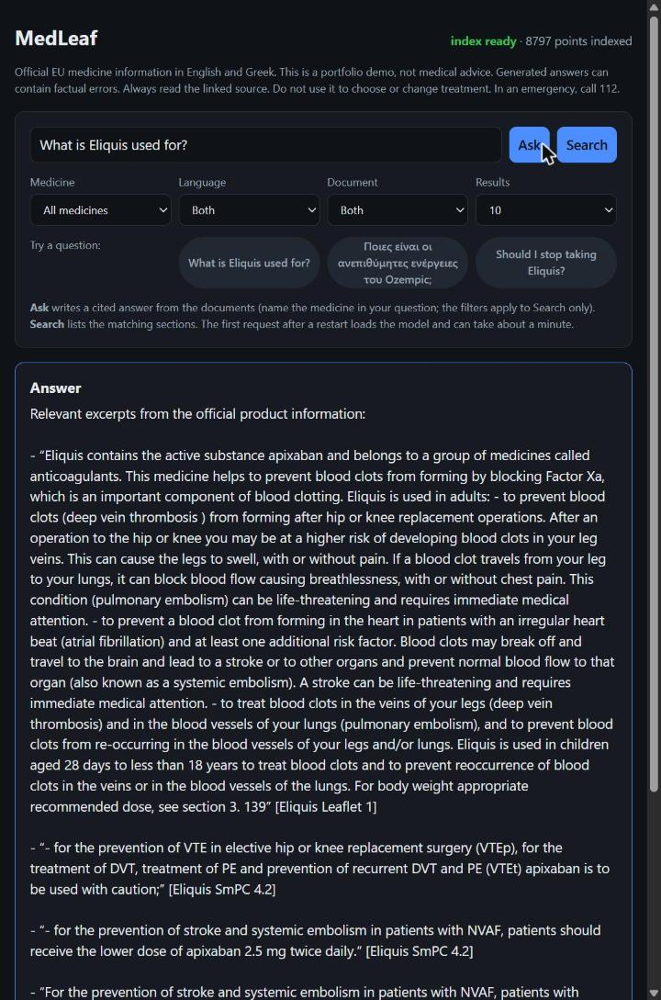
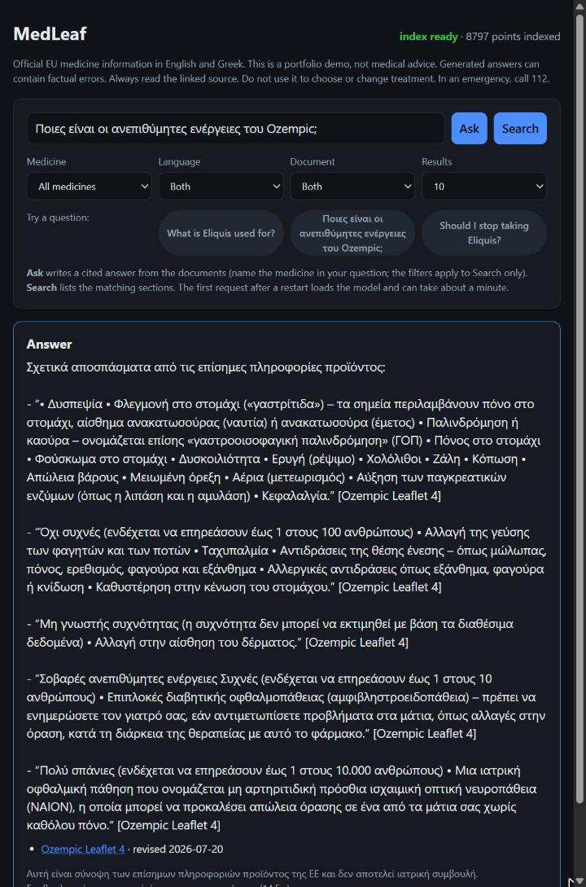
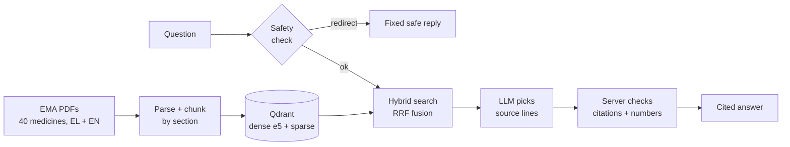

# MedLeaf RAG

[](https://github.com/NickLitharis/medleaf-rag/actions/workflows/ci.yml)

**Ask questions about EU medicines in Greek or English and get answers quoted from
official EMA documents, with a link to every source.**
Hybrid search (dense + keyword) over 8,797 chunks from 40 medicines, with safety
redirects for personal-treatment and emergency questions.

<p>
  
  
</p>

## How it works



Bilingual (Greek / English) question answering over official EU medicine
information, with cited answers and medical safety guardrails. The local demo
covers 40 centrally authorised medicines in both languages. It combines dense
and sparse retrieval through `/v1/search` and sends answer events through `/v1/ask`.
Generated text is checked before display; it is not shown token by token.
Open `http://127.0.0.1:8000/` after startup to use the browser demo.
A retrieval evaluation set gates every PR. Full answer evaluation is still pending.
See `SPEC.md` for the original milestone plan.

## Status

- **M1 — download + parse for five medicines (EN + EL):** complete. Evidence in
  `docs/M1-acceptance.md`.
- **M2 — 40 medicines, hybrid retrieval, `/v1/search`, Docker Compose:** complete.
  The rebuilt index has 8797 chunks, none over the model window, and all ten sample
  questions hit the expected section. Evidence in `docs/M2-acceptance.md`.
- **M3 — eval dataset v1, runner, retrieval gate:** in progress. 126 questions over
  dev/test medicines; dev baseline Recall@5 48/57 (84.2%), test 49/57 (86.0%).
  `.github/workflows/eval-retrieval.yml` fails a PR that loses more than one Recall@5
  hit. Still to show: the gate failing a real broken PR on GitHub. Run it locally with
  `PYTHONPATH=src python -m medleaf.cli eval --split dev --baseline eval/baseline.json`.
  Decisions in `docs/decisions.md`.
- **M4 — local answering demo:** implemented slices include streamed answers, EMA
  citation links, Greek/English detection, safety redirects and citation filtering.
  Numerical source-quote references are expanded by the server; raw generated digits
  are blocked before display. Full M4 acceptance is still pending.
- **M5–M7:** not complete. Tracing, full answer evaluation, optional fine-tuning
  and release evidence are not prerequisites for trying this local demo.

## Setup

Python 3.11 or later. The retrieval stack (torch, sentence-transformers, Qdrant
client, FastAPI) is an extra, so a plain checkout stays light:

```bash
python -m pip install -e ".[dev]"          # lint, type checks and the fast tests
python -m pip install -e ".[api,retrieval]"  # index build + API
```

On a machine that already has a CPU torch, a virtualenv with
`--system-site-packages` reuses it instead of downloading torch again:

```bash
uv venv --system-site-packages --python 3.11 .venv
uv pip install --python .venv/Scripts/python.exe -e ".[api,retrieval,dev]"
```

The embedding model is pinned by commit in `MEDLEAF_EMBED_REVISION`, downloaded to
`data/models` and recorded in the index manifest.

## Checks

```bash
PYTHONPATH=src python -m pytest -q          # fast tests, in-memory Qdrant
python -m ruff check .
```

The ten real EMA PDFs are not committed (`data/raw/` is ignored). To run the
corpus checks, download them first and then opt in:

```bash
PYTHONPATH=src python -m medleaf.cli resolve Eliquis Humira Jardiance Ozempic Xarelto
PYTHONPATH=src python -m medleaf.cli download
MEDLEAF_M1_CORPUS=1 PYTHONPATH=src python -m pytest tests/test_m1_acceptance.py -q
```

### Targeted numerical checks

`eval/answer-faithfulness.json` holds attributed English and Greek EMA excerpts
for the observed Ozempic dose–percentage reversal. Offline tests reject the swapped
answer, a correct quote followed by a swapped claim, and empty answers.

The six optional real-provider cases cover general, numerical and misleading
questions in both languages. Configure the provider variables shown under
“Try the local demo”, then run:

```powershell
$env:PYTHONPATH = "src"
$env:MEDLEAF_LIVE_FAITHFULNESS = "1"
python -m pytest tests/test_m4_faithfulness.py -q -s -k live
Remove-Item Env:MEDLEAF_LIVE_FAITHFULNESS
```

These tests use fixed context, without Qdrant or the safety classifier. They check
source-quote preservation and citation presence, not retrieval quality or general
medical accuracy. Explicit numerical questions must include the expected source
sentence; general questions can use a cited qualitative summary. Each live case
has a sixty-second deadline so provider reasoning cannot stall the check indefinitely.

With `MEDLEAF_LLM_SOURCE_QUOTES_ONLY=true`, the retained conservative NVIDIA
`openai/gpt-oss-20b` mode passed the six quote cases in 42.82 seconds. Two further
live cases remove the nausea evidence and require abstention. English passed;
Greek timed out before passing one bounded retry. The full live gate is therefore
not reliably green. These tests do not establish clinical or full-app acceptance.
Normal generated answers passed only three of six cases in a separate run;
low reasoning effort failed all six and was not adopted.

## Build the index and search

```bash
# 1. Resolve and download the 40-medicine corpus (network, respects EMA rate limits).
#    data/corpus-request.txt also lists the names EMA would not resolve, with reasons.
PYTHONPATH=src python -m medleaf.cli resolve --continue-on-error \
    $(grep -v '^#' data/corpus-request.txt | tr '\n' ' ')
PYTHONPATH=src python -m medleaf.cli download --workers 2

# 2. Run an isolated Qdrant and build the hybrid index
docker run -d --name medleaf-qdrant -p 127.0.0.1:6333:6333 qdrant/qdrant:v1.15.5
PYTHONPATH=src python -m medleaf.cli index build
PYTHONPATH=src python -m medleaf.cli index status

# 3. Search from the CLI or the HTTP API
PYTHONPATH=src python -m medleaf.cli search "What are the contraindications of Eliquis?" --lang en
PYTHONPATH=src uvicorn medleaf.api.app:create_app --factory --port 8000
curl "http://127.0.0.1:8000/v1/search?query=contraindications+of+Eliquis&lang=en&medicine=eliquis"
```

Every response carries full provenance (`chunk_id`, `source_url`, `revision_date`,
`corpus_version`). A missing index, an unreachable Qdrant or a model that cannot load
return HTTP 503 with an `error` code — the API never answers 200 with an empty list to
hide a broken index.

## Docker Compose

```bash
docker compose run --rm indexer        # build the index inside the stack
docker compose up -d api
curl "http://127.0.0.1:8000/v1/search?query=contraindications+of+Eliquis&lang=en"
```

Compose binds Qdrant and the API to loopback only, and the indexer runs as a one-shot
profile so `docker compose up` never rebuilds the index by accident. `data/` is mounted
from the host, so the corpus and the built index are not baked into images. Both
`indexer` and `api` use `pull_policy: build`, so every `run`/`up` rebuilds the image
from the current checkout first; a full index build fills a new collection and swaps
the `medleaf_chunks` alias only when it finishes, so the API keeps serving meanwhile.

## Try the local demo

The steps below require the downloaded corpus and an existing index. On a new
machine, first follow the index instructions above. The first search loads the
embedding model and can take about a minute.

Search works without an LLM key. Ask needs an OpenAI-compatible provider and a
valid key. In PowerShell, configure one before you start the API:

```powershell
# NVIDIA NIM developer endpoint. Availability and request limits can change.
$env:MEDLEAF_LLM_BASE_URL = "https://integrate.api.nvidia.com/v1"
$env:MEDLEAF_LLM_MODEL = "nvidia/nemotron-3-super-120b-a12b"
# Extractive answers: the model selects source lines; the server displays them.
$env:MEDLEAF_LLM_SOURCE_QUOTES_ONLY = "true"
$env:MEDLEAF_LLM_API_KEY = "<your-nvidia-key>"
docker compose up -d --build api
Start-Process "http://127.0.0.1:8000/"
```

NVIDIA retired `openai/gpt-oss-120b` on 2026-09-03, and `openai/gpt-oss-20b` timed
out on every call on 2026-10-16, so the demo now uses Nemotron 3 Super. The recorded
runs below used `gpt-oss-20b`.

Without these overrides, Compose uses OpenRouter and `openrouter/free`.
That router can select different underlying free models; it does not pin one
model for evaluations. The current local runtime uses the NVIDIA overrides above.
Its key comes from `MEDLEAF_LLM_API_KEY` or `OPENROUTER_API_KEY`.
Do not commit credentials. `docker compose restart api` preserves the current
container configuration. A later `docker compose up` reads the shell variables again.

Select a sample question, then select Ask or Search. Ask detects the answer
language from the question. The dropdown filters apply only to Search.

The NVIDIA setup above uses extractive answers: original source excerpts, not a
generated clinical explanation. Native JSON-schema output limits the model to
at most five existing source-line IDs. The server also checks the JSON shape,
ID types, count and values before rendering any text. An empty selection produces
a fixed abstention. Source relevance and extraction accuracy are not verified.
Set `MEDLEAF_LLM_SOURCE_QUOTES_ONLY=false` to use normal generation; false is
the Compose default. Enable extractive mode only on a provider that supports
the requested JSON schema. There is no silent fallback to unstructured output.

Try these paths:

- Ask `What is Eliquis used for?` for an English answer with EMA source links.
- Ask `Ποιες είναι οι ανεπιθύμητες ενέργειες του Ozempic;` to check the Greek path.
  The conservative mode abstained on this question in the recorded browser run.
- Ask `Should I stop taking Eliquis?` for a personal-treatment redirect.
- Ask `I took too many Eliquis tablets` for an emergency redirect without an LLM call.
- Ask `What does the product information say about Eliquis curing the common cold?`
  for an unsupported-claim example. Inspect the answer rather than assuming a refusal.

If the safety model fails or returns an invalid label, Ask returns HTTP 503 with
`safety_unavailable`. Use Search to read the official documents instead. A provider
failure during answer generation produces an SSE `error` event, not a completed answer.
The server collects the response before displaying text. It replaces `[quote:N]`
references with the original retrieved source lines and their citations. If the model
writes digits outside valid citations or quote references, or selects an unknown
quote reference, it emits `numerical_grounding_failed` without showing the answer.
This also rejects harmless numbered lists; it deliberately prefers withholding text
to exposing unverified figures. Quoted text stays in its source language.
The page reports index readiness only. It does not promise that the LLM provider is available.

### Current limits

This is a local portfolio demo, not a clinical tool or a quality-approved release.
Citation filtering removes invented source keys. It does not establish that a
sentence agrees with the cited text.

A live Greek test reversed the dose associations for nausea percentages in the
Ozempic source: 17% belongs to 0.5 mg, and 19.9% to 1 mg. The answer reversed them.
The numerical regression dataset and source-quote safeguard address this kind of
rewriting, but do not establish clinical reliability. The model can still select an
irrelevant quote. In normal generation mode, qualitative explanations and
spelled-out numbers are not verified. Extractive mode does not generate that
prose, but mistakes already present in extracted source text remain.
Broader real-model evaluation is still required before release.
Do not use generated answers for treatment decisions. Read the linked EMA source.

The retained mode completed eight browser requests. Five produced the expected
cited answer or safety redirect. Three Greek requests abstained, including one
with useful evidence available. English numerical and misleading questions took
5.64 and 14.89 seconds; the first English answer took 50.17 seconds after a cold
start. Personal and emergency redirects took 1.04 and 0.52 seconds. These are
single requests, not benchmarks or successful multilingual acceptance. Greek
retrieval coverage, selection precision and provider latency still need work.

## Medical disclaimer

This project is not medical advice and is not a substitute for a doctor or
pharmacist. Do not use it to decide on a dose, to stop or change a medicine, or in
an emergency. In an emergency in the EU, call 112.

## Licence and attribution

The code licence and the corpus licence are different. The medicine-information
PDFs and the text extracted from them are **copyright of the European Medicines
Agency (EMA)** and are not covered by any code licence; every copy must
acknowledge EMA as the source. The recorded EMA legal terms are in
`docs/M1-acceptance.md`. This repository claims no legal or clinical clearance.
